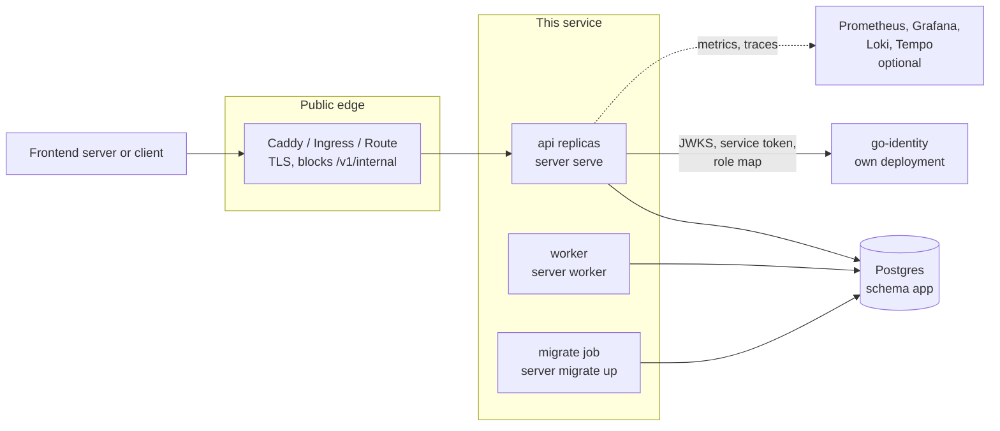
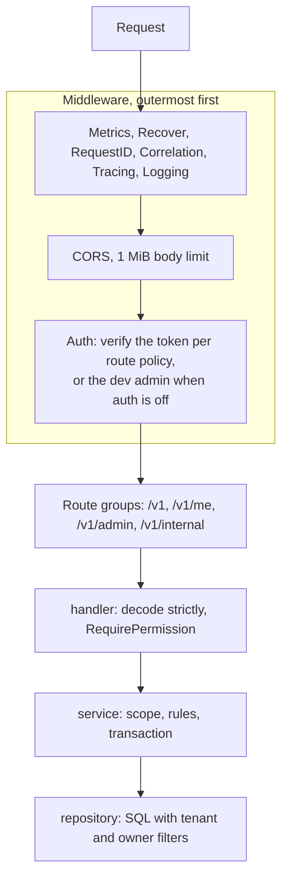
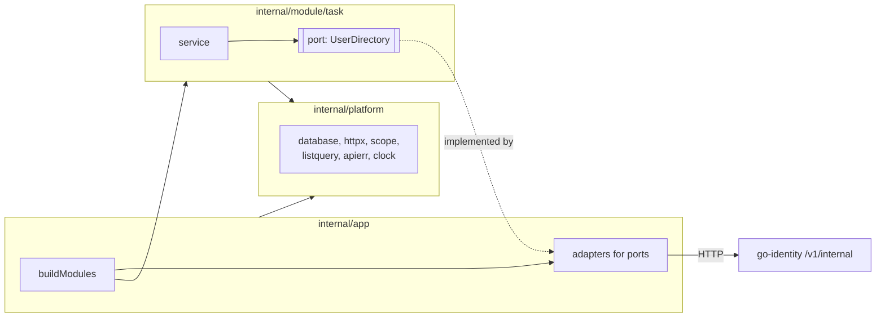
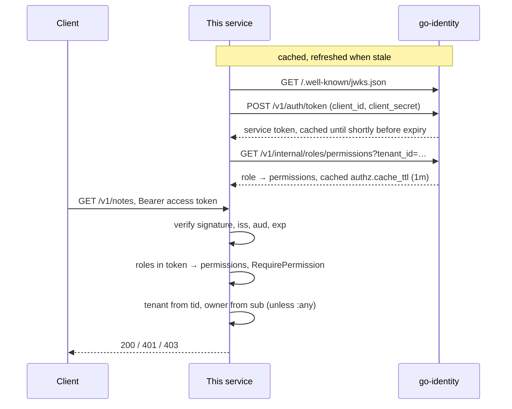

# Architecture

This is the map of go-service-template for an engineer new to it. It explains how a service built from it is
deployed, how a request moves through it, how modules fit together, how it trusts go-identity, and the patterns the
code repeats. Read it before the code.

Related documents:

- [README](../README.md) starts a project, adds a module or a migration, and deploys.
- [CONTRIBUTING](../CONTRIBUTING.md) and [AGENTS](../AGENTS.md) are the rules for changes.
- [PATTERNS](PATTERNS.md) has copy-paste code for every pattern below.
- [DECISIONS](DECISIONS.md) records why things are the way they are.

## Contents

1. [What the template is](#1-what-the-template-is)
2. [Deployed system](#2-deployed-system)
3. [Inside one request](#3-inside-one-request)
4. [Modules and how they talk](#4-modules-and-how-they-talk)
5. [Trusting go-identity](#5-trusting-go-identity)
6. [Patterns](#6-patterns)
7. [Where to look in the code](#7-where-to-look-in-the-code)

## 1. What the template is

A **resource service**: it owns business data (the example is notes), and never handles passwords or issues tokens.
[go-identity](https://github.com/biairmal/go-identity) signs users in. This service verifies identity's tokens, checks
permissions, and scopes every query by tenant and owner. It is built on [go-sdk](https://github.com/biairmal/go-sdk).

A client project starts with `gonew`, keeps `internal/app` and `internal/platform` as they are, replaces the `note`
module with its own modules, and adds migrations.

| Term | Meaning |
|---|---|
| Tenant | The organisation in the token's tenant claim (`tid`). Every row belongs to one |
| Owner | The user who created a row (`owner_id`, the token's `sub`). Plain permissions see only your own rows |
| `:any` permission | `notes:read:any` and `notes:write:any` widen a check from your own rows to every row in the tenant |
| Service token | A short-lived token this service gets from identity with its client ID and secret, to call identity's `/v1/internal` API |
| Dev admin | The fixed caller every request runs as when auth is off locally |

## 2. Deployed system

One image and one binary (`cmd/server`) run as three processes:

| Process | Command | Runs | Scaling |
|---|---|---|---|
| API | `serve` | The HTTP API | Stateless. 2 or more replicas (`API_REPLICAS` on Compose, HPA on Helm) |
| Worker | `worker` | The outbox dispatcher and the cleanup job | 1 is enough, and more are safe (rows are claimed with `SKIP LOCKED`) |
| Migrate | `migrate up` | Applies the embedded migrations, then exits | Once per release, before the new API starts |

- **Postgres is the one hard dependency.** `/readyz` fails when the leader database is unhealthy.
- **Identity is off the request path.** Keys and the role map are cached, so a short identity outage doesn't stop
  requests (section 5).
- **Zero-downtime deploys.** On Compose, `deploy.sh` starts new replicas next to the old ones and stops the old
  ones only when the new ones are ready. A stopping replica answers 503 on `/readyz` for `DRAIN_DELAY`, then drains
  in-flight requests (go-sdk `lifecycle`).

| | Kubernetes (Helm) | Single VPS (Compose) |
|---|---|---|
| Files | [deploy/helm/service](../deploy/helm/service) | [deploy/compose](../deploy/compose) |
| Migrations | `pre-install` / `pre-upgrade` hook Job | `migrate` service, run by `deploy.sh` |
| Edge | Ingress or OpenShift Route, `/v1/internal` denied | Caddy (automatic TLS), `/v1/internal` answers 404 |
| Pods | Non-root, read-only root filesystem, OpenShift `restricted-v2` compatible | — |
| Extras | HPA, PDB, ServiceMonitor | Daily `pg_dump`, optional `obs` profile |

[deploy/sql/bootstrap.sql](../deploy/sql/bootstrap.sql) creates the `app` role and schema once per environment. The
service and identity can share one Postgres database, each in its own schema.

## 3. Inside one request

- **Route policy.** Every route needs a token unless `auth.rules` in [config/config.yaml](../config/config.yaml)
  lists it as public (health, readiness, version, metrics, Swagger).
- **Permissions.** Each handler wraps its route with go-sdk `middleware.RequirePermission`. The service then narrows
  by owner unless the caller holds the `:any` permission.
- **Groups are built once** in [internal/app/routes.go](../internal/app/routes.go). Modules only mount routes into
  them.
- **Errors** go back as `errorz` codes, and `httpx.Handle` writes the standard envelope with the right status.
  Finer reasons go in `meta.reason` (`VERSION_CONFLICT`).

## 4. Modules and how they talk

A module is one feature boundary in `internal/module/<name>` with a fixed layout: `module.go` (`New(cfg, Deps)` and
`Register`), `config.go`, `model.go`, `dto.go`, `handler.go`, `service.go`, `repository.go`. The `note` module is the
worked example: CRUD, `If-Match` versioning, paged and filtered lists, an options endpoint, bulk delete, owner
scoping.

- **No module imports another**, and `internal/app/arch_test.go` enforces it. A module that needs data from another
  module, or from another service, declares a small interface (a **port**) and `internal/app` provides an
  **adapter**. The README's [Call identity's internal API](../README.md#call-identitys-internal-api) shows a
  complete one.
- **`internal/platform` holds no business rules** and never imports `app` or a module.
- **Transactions cross ports.** `database.WithTx` puts the transaction on the context, and every repository uses it
  when present, so writes from several modules commit together.
- **Adding a module** is a directory, one line in `buildModules`, one config block, and a migration. The README's
  [Add a module](../README.md#add-a-module) has the steps.

## 5. Trusting go-identity

| Setting | What it does |
|---|---|
| `auth.local.jwks_url`, `issuer`, `audience` | Where identity's keys are, and which tokens to accept |
| `authz.source` | `identity` (default: the role map from identity), `token` (the `perms` claim), or `config` (a fixed map) |
| `identity.client_id`, `client_secret` | This service's entry in identity's `modules.auth.service_clients` |
| `tenancy.mode` | Must match identity's |

[internal/app/service_token.go](../internal/app/service_token.go) fetches and caches the service token. `authz`
and any adapter that calls `/v1/internal` share it. With auth off, every request carries the dev admin's claims and
`authz` uses a fixed role map with `admin: ["*"]`, so all of this runs without identity. `make up-identity` runs
the real flow locally.

## 6. Patterns

Each pattern solves one recurring problem. [PATTERNS.md](PATTERNS.md) has the code to copy.

| Pattern | Problem | How |
|---|---|---|
| Tenant and owner scope | A forgotten filter leaks another tenant's rows | `scope.Tenant` and `scope.Owner` read only from the token and fail with 401 when missing. Repositories add `tenant_id` to every `WHERE` |
| Optimistic locking | Two editors silently overwrite each other | A `version` column, `If-Match` on `PATCH` and `DELETE`, 409 `VERSION_CONFLICT` on a stale version |
| Intent updates | A save resets a field it didn't mean to touch | Updates name their columns instead of saving a whole struct |
| Allow-listed list queries | Arbitrary sort and filter input reaches SQL | `listquery` parses `page`, `size`, `sort` and filters against a per-endpoint allow-list |
| Transactional outbox | A side effect is sent for a change that rolled back, or lost for one that committed | Enqueue in the caller's transaction. The worker dispatches with `SKIP LOCKED` and exponential backoff. Delivery is at least once |
| Advisory locks | A rule spans rows a plain `UPDATE` can't protect | `database.LockXact` serialises the competing transactions |
| Leader and follower reads | Read load on the primary | Reads that don't need their own writes may go to a follower. Writes and read-your-writes use the leader |
| Expand, then contract migrations | A deploy breaks the replicas still running old code | Each migration works with the code already running. Drop old columns in a later release |
| Ports and adapters | Modules tangle, and tests need the real dependency | Consumer-owned interfaces, wired in `internal/app`, faked in tests |
| Cleanup | Sent outbox rows grow without bound | The worker deletes sent and expired rows in bounded batches once a day |

## 7. Where to look in the code

| Question | Open |
|---|---|
| How is the service wired? | [internal/app/app.go](../internal/app/app.go), [internal/app/module.go](../internal/app/module.go) |
| Which routes need which token? | [config/config.yaml](../config/config.yaml) `auth.rules`, [internal/app/routes.go](../internal/app/routes.go) |
| What does a complete module look like? | [internal/module/note](../internal/module/note) |
| How do tenant and owner filters work? | [internal/platform/scope](../internal/platform/scope/scope.go) |
| How does it talk to identity? | [internal/app/service_token.go](../internal/app/service_token.go) |
| What runs in the background? | [internal/app/worker.go](../internal/app/worker.go) |
| What does an endpoint accept and return? | Swagger UI at `/swagger/index.html`, or [api/swagger](../api/swagger) |
| How do I operate it? | [docs/runbooks](runbooks) |
